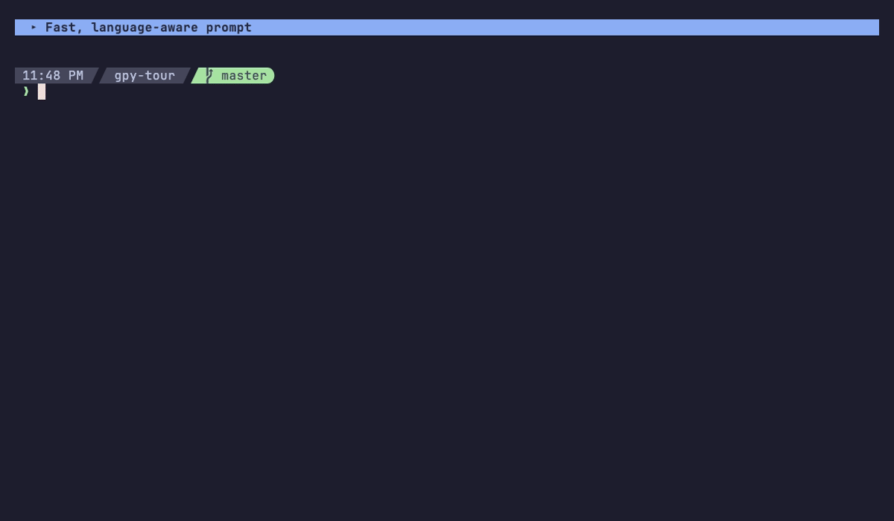

[](https://www.gnu.org/licenses/gpl-3.0)

# GPY: Guppy Prompt, Yay!

GPY is a shell prompt for Fish, Zsh and Bash. A small background agent watches
your repositories, so the prompt shows git and language state without running
`git status` on every command.

If the agent is not running, the prompt still draws; it computes each segment
itself, which is slower. Timeouts and other tuning:
[Environment Variables](docs/user/environment-variables.md).

<p align="center">
  
</p>

## Features

- [Supported Platforms and Shells](docs/INSTALL.md#supported-platforms-and-shells)
  - macOS, Linux, and Windows through WSL
  - Fish, Zsh, and [Bash with some limitations](docs/user/bash-limitations.md)
- [Git detection](docs/user/configuration-reference.md#git)
- [Language detection](docs/user/configuration-reference.md#language)
- [Themes](docs/user/theme-customization.md), including [import of Starship](docs/user/migrating-from-starship.md) `starship.toml`
- [Palettes](docs/user/palettes.md), including import of [tinted-theming](https://github.com/tinted-theming/schemes)
  base16/base24 schemes

## Performance

A whole prompt (clock, duration, directory and git) takes GPY 3–6 ms on macOS
and about 1.5 ms on Linux, in Bash, Zsh and Fish alike, because git status
comes from the agent's cache. Starship 1.27.0 takes 18–20 ms on a small
repository and about 130 ms on kubernetes on the same Mac (2026-11-19, GPY
0.12 code). Without the agent, one `gpy-agent oneshot` git request is about
1.25 times faster than Starship's on small repositories and 1.35 to 2.2 times
faster on large ones.

The large-repository `oneshot` lead depends on git's untracked cache being
present in the repository's index. The GPY agent adds git's untracked cache
to a repository's index where `core.untrackedCache` is unset, and your own git
commands can add it too; the benchmark primes it itself before timing.
`gpy-agent oneshot` never adds it, GPY never writes your git config, and a
value you set yourself is respected.
[How it was measured, and how to run it yourself](docs/user/performance-vs-starship.md).

## Install

> More info: [Installation & Troubleshooting Guide](docs/INSTALL.md).

### Requirements

- No IPC client is needed: `gpy` talks to the agent's socket itself.
- The default prompt uses [Nerd Font](https://www.nerdfonts.com) glyphs. `gpy
  setup` switches to ASCII icons when it finds no Nerd Font; see
  [Icons and Nerd Fonts](docs/INSTALL.md#icons-and-nerd-fonts).
- Supported systems and shell versions:
  [Supported Platforms and Shells](docs/INSTALL.md#supported-platforms-and-shells).

### Curl

```bash
curl -fsSL https://github.com/jpease/gpy/releases/latest/download/install-oneline.sh | sh
exec fish  # or: exec zsh / exec bash
```

The installer is an asset of the latest release and checks every download
against that release's published checksums; see
[what the checksums do and do not prove](docs/INSTALL.md#what-the-checksums-do-and-do-not-prove).

### Homebrew

```bash
brew install jpease/tap/gpy
gpy setup
exec "$SHELL"
```

### From source

> Needs Rust 1.99+. See [Building from Source](docs/INSTALL.md#building-from-source).

```bash
git clone https://github.com/jpease/gpy.git
cd gpy
(cd gpy-agent && cargo build --profile release-dist)
mkdir -p ~/.local/bin
install -m 755 gpy-agent/target/release-dist/gpy-agent gpy-agent/target/release-dist/gpy ~/.local/bin/
~/.local/bin/gpy setup --from .
```

## Usage

```bash
gpy status                                # agent status and diagnostics
gpy doctor                                # health checks
gpy theme list
gpy theme use <name>                      # switch theme
gpy config wizard                         # interactive theme, palette and segment setup
gpy theme import ~/.config/starship.toml --name my-prompt
gpy palette import scheme.yaml
```

Tab completion for `gpy` is installed for all three shells.

## Documentation

- [Installation Guide](docs/INSTALL.md)
- [User guide](docs/user/README.md), [CLI reference](docs/user/cli-reference.md),
  and [Advanced Configuration](docs/user/advanced-configuration.md)
- [Migrating from Starship](docs/user/migrating-from-starship.md)
- [GPY vs Starship performance](docs/user/performance-vs-starship.md)
- [Developer docs](docs/dev/README.md)

## Contributing

See [CONTRIBUTING.md](CONTRIBUTING.md). `just check` runs the full gate. To run an
unreleased build in an isolated shell without touching an installed release, see
[`scripts/README.md`](scripts/README.md) (`just dev` / `scripts/gpy-dev.sh`).

## License

GPL-3.0-or-later. See [LICENSE](LICENSE).
