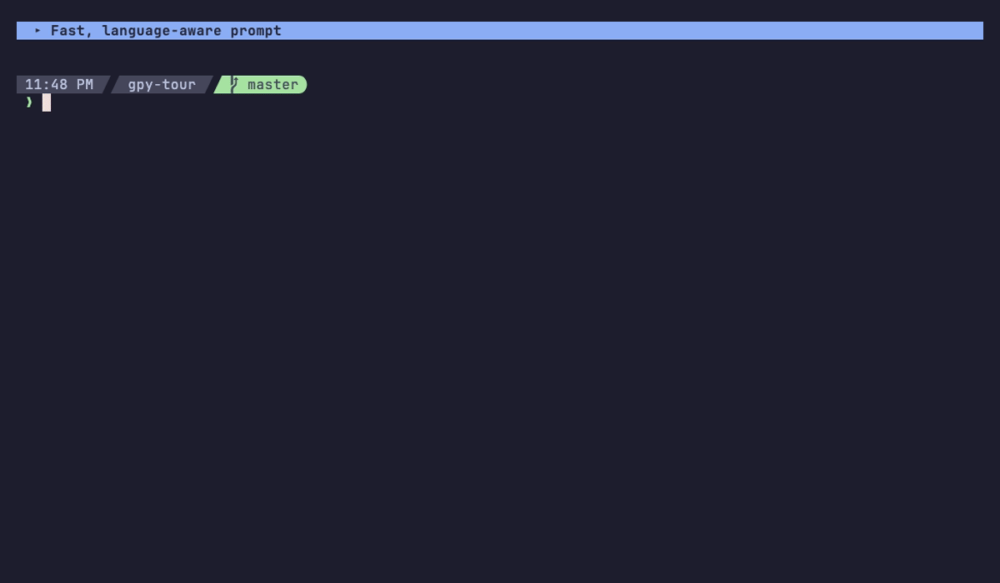

[](https://www.gnu.org/licenses/gpl-3.0)

# GPY: Guppy Prompt, Yay!

GPY is a shell prompt for Fish, Zsh and Bash. Its git and language detection
runs in a small background daemon that watches your repositories, so the
prompt draws from a cache instead of running `git status` each time. When the
cache is warm, the prompt waits at most 150 ms (`GPY_IPC_TIMEOUT_MS`) for the
agent. With nothing cached yet it waits up to 500 ms
(`GPY_IPC_COLD_TIMEOUT_MS`), so a busy machine still draws the segment, and
otherwise draws without it.

<p align="center">
  
</p>

## Features

- [Supported Platforms and Shells](docs/INSTALL.md#supported-platforms-and-shells)
  - macOS, Linux, and Windows through WSL
  - Fish, Zsh, and [Bash with some limitations](docs/user/bash-limitations.md)
- [Git detection](docs/user/configuration-reference.md#git)
- [Language detection](docs/user/configuration-reference.md#language)
- [Themes](docs/user/theme-customization.md), including [import of Starship](docs/user/migrating-from-starship.md) `starship.toml`
- [Palettes](docs/user/palettes.md), including import of [tinted-theming](https://github.com/tinted-theming/schemes)
  base16/base24 schemes

## Not too slow

Time for one git-status prompt segment (median, ms; lower is better).

| Repository (tracked files) | GPY (v0.4.0) | Starship (1.26.0) |
|---|---:|---:|
| tiny-express (225) | 10.2 | 10.7 |
| small-redis (1,680) | 11.4 | 11.6 |
| medium-kubernetes (27,597) | **55.8** | 113.7 |
| large-tensorflow (34,570) | **51.8** | 71.1 |

- Measured as a single process call on pinned repositories, clean working tree
- Apple M4 Max (macOS 27.0.1, git 2.56.0)

These numbers time the no-daemon `oneshot` path, the like-for-like process
comparison. With the daemon running, the same request on the two large
repositories takes about 3.5 ms (median, including starting `socat`). The GPY
agent adds git's untracked cache to a repository's index where
`core.untrackedCache` is unset, and your own git commands can add it too; the
benchmark primes it itself before timing. `gpy-agent oneshot` never adds it,
GPY never writes your git config, and a value you set yourself is respected.
See [how it was measured and how to run it
yourself](docs/user/performance-vs-starship.md).

## Install

> More info: [Installation & Troubleshooting Guide](docs/INSTALL.md).

### Curl

```bash
curl -fsSL https://github.com/jpease/gpy/releases/latest/download/install-oneline.sh | sh
exec fish  # or: exec zsh / exec bash
```

The installer is an asset of the latest release and checks every download
against that release's published checksums; see
[what the checksums do and do not prove](docs/INSTALL.md#what-the-checksums-do-and-do-not-prove).

### Homebrew

```bash
brew install jpease/tap/gpy
gpy setup
exec "$SHELL"
```

### From source

> Needs Rust 1.99+. See [Building from Source](docs/INSTALL.md#building-from-source).

```bash
git clone https://github.com/jpease/gpy.git
cd gpy
(cd gpy-agent && cargo build --profile release-dist)
mkdir -p ~/.local/bin
install -m 755 gpy-agent/target/release-dist/gpy-agent gpy-agent/target/release-dist/gpy ~/.local/bin/
~/.local/bin/gpy setup --from .
```

## Usage

```bash
gpy status                                # agent status and diagnostics
gpy doctor                                # health checks
gpy theme list
gpy theme import ~/.config/starship.toml --name my-prompt
gpy palette import scheme.yaml
```

Tab completion for `gpy` is installed for all three shells.

## Documentation

- [Installation Guide](docs/INSTALL.md)
- [User guide](docs/user/README.md), [CLI reference](docs/user/cli-reference.md),
  and [Advanced Configuration](docs/user/advanced-configuration.md)
- [Migrating from Starship](docs/user/migrating-from-starship.md)
- [GPY vs Starship performance](docs/user/performance-vs-starship.md)
- [Developer docs](docs/dev/README.md)

## Contributing

See [CONTRIBUTING.md](CONTRIBUTING.md). `just check` runs the full gate. To run an
unreleased build in an isolated shell without touching an installed release, see
[`scripts/README.md`](scripts/README.md) (`just dev` / `scripts/gpy-dev.sh`).

## License

GPL-3.0-or-later. See [LICENSE](LICENSE).
